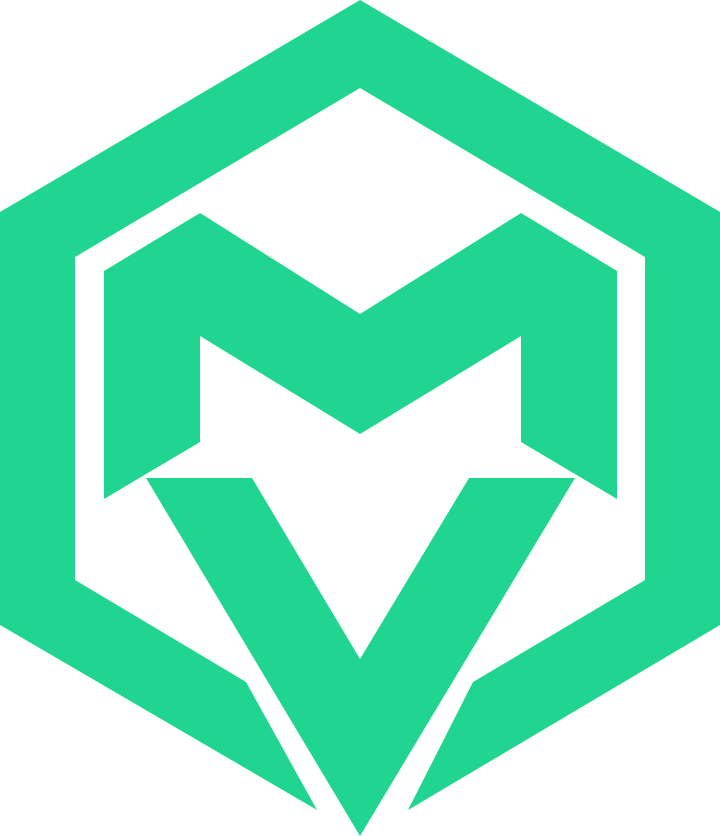

<p align="center"></p>
<h1 align="center">MV Spatial · Matías Villalobos</h1>
<p align="center"><strong>Unity Developer | XR / VR Developer</strong></p>
<p align="center">Proyectos personales, gameplay y experiencias 3D interactivas.</p>
<p align="center"><a href="https://matixvc.github.io/portafolio-web/">Visitar el portafolio</a> · <a href="README.md">English</a> · <strong>Español</strong></p>
<p align="center">  </p>

## Sobre el portafolio

Mi portafolio personal presenta proyectos personales y académicos de videojuegos, Unity, C#, interacción 3D y XR. Reúne resúmenes de proyectos, repositorios, descargas bilingües del CV y medios de contacto profesional.

`main` contiene el portafolio estable aprobado hasta las fases 9.1 y 9.2. GitHub Pages todavía sirve la versión anterior desde `portfolio/professional-refresh`; cambiar su fuente a `main` queda pendiente de confirmación manual del autor.

## Características

- Diseño responsive para móvil, tablet y escritorio.
- Temas Claro, Oscuro y Sistema; Sistema es la preferencia predeterminada. Las elecciones explícitas persisten cuando el almacenamiento del navegador está disponible.
- Identidad SVG MV Spatial y favicon que sigue el esquema de color del sistema.
- Secciones semánticas, navegación por teclado, foco visible, menú móvil, diálogos de proyectos y soporte de movimiento reducido.
- Tarjetas de proyectos con detalles y enlaces a repositorios.
- Descargas independientes del CV en español e inglés.
- Integración Web3Forms, validación de campos, prevención de doble envío, copia de correo y alternativa por email.
- Alojamiento estático en GitHub Pages, con CSS compilado y sprite de iconos versionados.

La entrega real de mensajes no se prueba durante la consolidación; no se autorizan envíos del formulario durante QA.

## Proyectos y alcance profesional

| Proyecto | Alcance actual | Código |
| --- | --- | --- |
| PhysicsVR Prototype | Prototipo de interacción física en Unity/C#, en desarrollo y orientado a una futura integración VR. **Todavía no es funcional con visor VR.** | [Repositorio](https://github.com/Matixvc/PhysicsVR_Prototype) |
| Basura Fighters | Roguelike de reciclaje para navegador con JavaScript y Canvas 2D. | [Repositorio](https://github.com/Matixvc/Trash-Roguelike) · [Demo](https://trash-rogelike.netlify.app) |
| App Mobile | Organizador personal con Expo, React Native y TypeScript. | [Repositorio](https://github.com/Matixvc/App-Mobile) |

La colaboración académica XR bajo NDA es independiente de PhysicsVR. Su descripción pública se limita a pruebas funcionales en Meta Quest 3 y reporte de incidencias. Las ilustraciones de proyectos son actualmente mockups SVG; las capturas y recursos multimedia reales siguen pendientes.

## Tecnologías

**Sitio web:** HTML estático, JavaScript vanilla y Tailwind CSS 3. Font Awesome proporciona los SVG fuente del sprite local. Las dependencias npm son herramientas de desarrollo; el sitio no requiere framework frontend ni bundle npm en ejecución. El contacto utiliza Web3Forms.

**Perfil profesional:** Unity y C# son el foco principal, junto con gameplay, interacción física, 3D y exploración XR. Unreal Engine, Python, Git/GitHub, Blender y Photoshop aparecen como herramientas complementarias. No son dependencias del sitio. Expo, React Native y TypeScript corresponden a App Mobile.

## Estructura del proyecto

```text
portafolio-web/
├── index.html
├── js/                     # main.js: interacciones; theme.js: preferencias de tema
├── src/                    # input.css y plantillas históricas CV/OG/icono
├── scripts/                # Generación de iconos, render y actualización de URLs
├── assets/
│   ├── brand/              # SVG MV Spatial, favicon y references/
│   ├── icons.svg           # Sprite generado
│   ├── Matias_Villalobos_CV_Unity_XR_ES.pdf
│   └── Matias_Villalobos_CV_Unity_XR_EN.pdf
├── dist/styles.css         # CSS generado
├── docs/PROJECT_STATUS.md
├── AGENTS.md
├── README.md / README.es.md
├── package.json / package-lock.json
├── tailwind.config.js
└── site.webmanifest / robots.txt / sitemap.xml
```

## Desarrollo local

Requiere Node.js y npm. Clona la versión estable desde `main`:

```sh
git clone --branch main https://github.com/Matixvc/portafolio-web.git
cd portafolio-web
npm ci
npm run build
npm run serve
```

La versión estable está en `main`; `feature/portfolio-consolidation` se conserva como rama de consolidación. Consulta las evidencias de integración en [PROJECT_STATUS.md](docs/PROJECT_STATUS.md). `npm ci` instala las versiones bloqueadas. `npm run serve` utiliza `npx --yes serve .` y puede descargar el servidor; usa la URL indicada en la terminal, normalmente `http://localhost:3000`. Detén el servidor con Ctrl+C. Si PowerShell bloquea `npm.ps1`, utiliza `npm.cmd`.

| Comando | Función |
| --- | --- |
| `npm run build` | Regenera el sprite de iconos y el CSS minificado. |
| `npm run watch` | Recompila CSS mientras editas `src/input.css`. |
| `npm run icons` | Regenera únicamente `assets/icons.svg` desde `scripts/build-icons.mjs`. |
| `npm run serve` | Sirve el proyecto localmente. |
| `npm run set-url -- --dry https://example.com` | Previsualiza cambios de URL en metadatos; retira `--dry` solo para un cambio intencional de dominio. |
| `npm run og` | Renderiza el arte OG existente mediante Edge; sobrescribe recursos generados. |
| `npm run cv` | Exporta la plantilla histórica `src/cv.html` a `assets/cv-matias-villalobos.pdf` mediante Edge. **No** actualiza los PDF ES/EN vigentes. |

Edita las fuentes CSS/iconos y regenera las salidas. No edites manualmente `dist/styles.css` ni `assets/icons.svg`. Ejecuta exportaciones OG/CV únicamente dentro de una actualización de recursos aprobada.

Comprobaciones básicas: `node --check js/main.js`, `node --check js/theme.js`, `node --check tailwind.config.js`, `git diff --check`. No hay `npm test` ni lint configurados. El QA de navegador debe cubrir temas, recarga/persistencia, teclado, menús, diálogos, enlaces del CV y anchos 390/768/1440. No envíes el formulario sin autorización.

## Git y publicación

- **Rama pública actual:** `portfolio/professional-refresh`, último despliegue verificado `20b49ad`. Mantener la configuración de Pages.
- **Rama estable:** `main`, con el portafolio recuperado y aprobado hasta la fase 9.2.
- **Flujo de desarrollo:** ramas temporales `feature/*` desde `main`; sin `develop` permanente. Conservar `feature/portfolio-consolidation` y las ramas e historial existentes.
- Revisar diff y staging, crear commits acotados y versionar CSS/iconos generados junto con sus fuentes.
- Subir ramas feature únicamente tras verificar que los triggers de Pages/Actions no puedan publicarlas. Publicar requiere aprobación explícita.
- **Paso manual de publicación pendiente:** el autor puede seleccionar Settings → Pages → Deploy from a branch → `main` → `/ (root)`. No describir `main` como fuente pública hasta verificar ese cambio y el despliegue. Actualizar `main` por sí solo no cambia la fuente actual de Pages.

GitHub es el respaldo principal tras verificar el commit remoto. Utilizar recursos temporales de recuperación solo cuando sean necesarios. Eliminar respaldos permanentes existentes, referencias de recuperación o stash requiere autorización explícita.

## Identidad MV Spatial

El símbolo aprobado combina una M superior, una V inferior y geometría hexagonal abierta. Recursos reutilizables en [`assets/brand/`](assets/brand/): `mv-spatial.svg`, `mv-spatial-dark.svg`, `mv-spatial-light.svg`, `mv-spatial-monochrome.svg`, `favicon.svg`; las imágenes originales están en `references/`.

Verde esmeralda principal/oscuro: `#20D58F`; variante clara: `#07844F`; monocromática: `currentColor`. El encabezado selecciona su variante según el tema efectivo. La interfaz conserva acentos cian `#00F2FE`, violeta `#7928CA` y azul `#0070F3`, con tokens semánticos claro/oscuro en `src/input.css`. El sistema de diseño completo MV Spatial sigue pendiente.

## Estado y roadmap

Completado hasta la fase 9.2: integridad y mejoras funcionales, posicionamiento profesional, preferencias de temas y símbolo/favicon MV Spatial aprobado. Evidencias y limitaciones: [PROJECT_STATUS.md](docs/PROJECT_STATUS.md).

Previsto:

- Fase 9.3: sistema de diseño visual MV Spatial.
- Arte original del Hero y Projects Showcase.
- Portadas, capturas y videos de proyectos.
- Modelos y experiencias 3D, animaciones e interacciones.
- Banners profesionales y actualización de Open Graph.

Los PDF ES/EN existentes se conservan. Su descripción de PhysicsVR requiere una corrección aprobada por separado. También mencionan 40 Days of Light, cuya evidencia y alcance deben prepararse antes de añadirlo al sitio. Siguen pendientes protecciones adicionales de contacto, pruebas ampliadas de navegadores/accesibilidad, sitio en inglés y casos de estudio. No se incluyen nuevos banners de IA.

## Contacto

[Portafolio](https://matixvc.github.io/portafolio-web/) · [GitHub](https://github.com/Matixvc) · [LinkedIn](https://www.linkedin.com/in/matias-vc-dev) · [Correo](mailto:Matias.villalobos.dev@gmail.com)

[CV · Español](assets/Matias_Villalobos_CV_Unity_XR_ES.pdf) · [CV · English](assets/Matias_Villalobos_CV_Unity_XR_EN.pdf)
