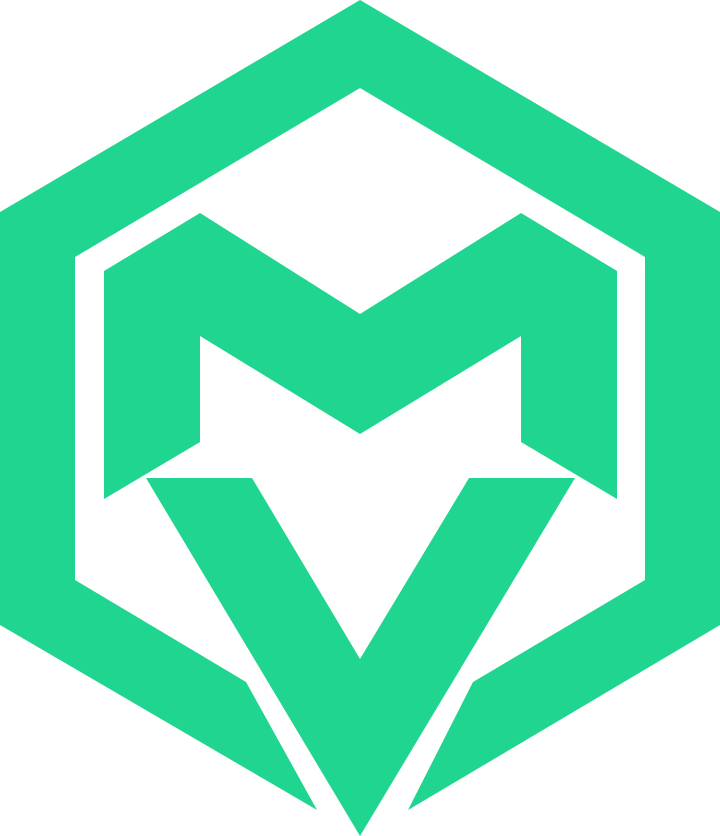

<p align="center">
  <a href="https://matixvc.github.io/portafolio-web/"></a><br>
  <a href="https://matixvc.github.io/portafolio-web/">https://matixvc.github.io/portafolio-web/</a>
</p>
<p align="center"></p>
<h1 align="center">MV Spatial · Matías Villalobos</h1>
<p align="center"><strong>Unity Developer | XR / VR Developer</strong></p>
<p align="center">Proyectos personales y académicos en Unity, gameplay e interacción 3D, con enfoque en exploración XR.</p>
<p align="center"><a href="README.md" lang="en">Inglés</a> · <a href="README.es.md" lang="es">Español</a></p>
<p align="center">  </p>

## Sobre el portafolio

Mi portafolio personal presenta proyectos personales y académicos de videojuegos, Unity, C#, interacción 3D y XR. Reúne resúmenes de proyectos, repositorios, descargas bilingües del CV y medios de contacto profesional.

La rama local `main` apunta a `6694014` e incluye el portafolio hasta la fase 9.4, incluidas las fases 9.4B, 9.4C y 9.4D.1. La fase 9.5 está implementada y verificada localmente como cambios sin commit en `feature/portfolio-consolidation`; no está en `main`.

`main` es la rama estable y la fuente configurada de GitHub Pages es `main` → `/ (root)`. La URL del portafolio es [matixvc.github.io/portafolio-web](https://matixvc.github.io/portafolio-web/). Durante la fase 9.4.0 se verificó localmente el commit `dd271b3` en `main`, `feature/portfolio-consolidation` y sus referencias remotas locales; no fue posible revalidar de forma independiente el commit remoto en vivo ni la página desplegada porque el acceso de red no estaba disponible. Evidencias y limitaciones: [PROJECT_STATUS.md](docs/PROJECT_STATUS.md).

## Características

- Diseño responsive para móvil, tablet y escritorio.
- Temas Claro, Oscuro y Sistema; Sistema es la preferencia predeterminada. Las elecciones explícitas persisten cuando el almacenamiento del navegador está disponible.
- Identidad SVG MV Spatial y favicon que sigue el esquema de color del sistema.
- Cinco secciones semánticas en este orden: Inicio → Proyectos → Acerca de mí → Tecnologías → Contacto. La cronología académica forma parte de Acerca de mí y `#formacion` se conserva como ancla compatible.
- Navegación por teclado, foco visible, menú móvil, cuatro diálogos de proyectos y soporte de movimiento reducido.
- Tarjetas Project Showcase con cubiertas SVG conceptuales más amplias, estados claros, respuesta sutil a hover/foco y enlaces a repositorios cuando existen. Se conservan los cuatro diálogos accesibles.
- Descargas independientes del CV en español e inglés.
- Integración Web3Forms, validación de campos, prevención de doble envío, copia de correo y alternativa por email. En pantallas pequeñas el correo y el botón de copia ocupan filas separadas; «Volver arriba» pasa a la derecha y contempla el área segura inferior.
- Sitio estático preparado para GitHub Pages, con CSS compilado y sprite de iconos versionados.

La entrega real de mensajes no se prueba durante la consolidación; no se autorizan envíos del formulario durante QA.

## Proyectos y alcance profesional

| Proyecto | Alcance actual | Código |
| --- | --- | --- |
| PhysicsVR Prototype | Prototipo de interacción física en Unity/C#, en desarrollo y orientado a una futura integración VR. **Todavía no es funcional con visor VR.** | [Repositorio](https://github.com/Matixvc/PhysicsVR_Prototype) |
| Basura Fighters | Roguelike de reciclaje para navegador con JavaScript y Canvas 2D. | [Repositorio](https://github.com/Matixvc/Trash-Roguelike) · [Demo](https://trash-rogelike.netlify.app) |
| NexusDay (App Mobile) | Proyecto móvil desarrollado con React Native y Expo. | [Repositorio](https://github.com/Matixvc/App-Mobile) |
| Jefferson Motel | Recreación 3D en desarrollo con Blender. No tiene repositorio ni demo públicos; una posible integración futura con Unity no es una funcionalidad completada. | No público |

La colaboración académica XR bajo NDA es independiente de PhysicsVR. Su descripción pública se limita a pruebas funcionales en Meta Quest 3 y reporte de incidencias. Las ilustraciones de proyectos son actualmente mockups SVG; las capturas y recursos multimedia reales siguen pendientes.

## Tecnologías

**Sitio web:** HTML estático, JavaScript vanilla y Tailwind CSS 3. Font Awesome proporciona los SVG fuente del sprite local. Las dependencias npm son herramientas de desarrollo; el sitio no requiere framework frontend ni bundle npm en ejecución. El contacto utiliza Web3Forms.

**Perfil profesional:** Unity y C# son el foco principal, junto con gameplay, interacción física, 3D y exploración XR. Unreal Engine, Python, Git/GitHub, Blender y Photoshop aparecen como herramientas complementarias. No son dependencias del sitio. Expo, React Native y TypeScript corresponden a NexusDay.

La sección Tecnologías agrupa este alcance en cuatro paneles: tecnologías principales; motores y herramientas 3D; desarrollo y herramientas; y desarrollo complementario. XR/VR se presenta como enfoque, incluida la colaboración académica de pruebas en Meta Quest 3 bajo NDA, no como una función de PhysicsVR completada con visor.

Un bloque compacto **AI-Assisted Development** describe ChatGPT como apoyo en desarrollo, programación, análisis y planificación; Gemini para productividad cotidiana, investigación y apoyo creativo; y Claude como apoyo complementario en tareas técnicas y creativas. El autor evalúa y verifica los resultados antes de incorporarlos a sus proyectos.

## Estructura del proyecto

```text
portafolio-web/
├── index.html
├── js/                     # main.js: interacciones; theme.js: preferencias de tema
├── src/                    # input.css y plantillas históricas CV/OG/icono
├── scripts/                # Generación de iconos, render y actualización de URLs
├── assets/
│   ├── brand/              # SVG MV Spatial, favicon y references/
│   ├── icons.svg           # Sprite generado
│   ├── Matias_Villalobos_CV_Unity_XR_ES.pdf
│   └── Matias_Villalobos_CV_Unity_XR_EN.pdf
├── dist/styles.css         # CSS generado
├── docs/PROJECT_STATUS.md
├── AGENTS.md
├── README.md / README.es.md
├── package.json / package-lock.json
├── tailwind.config.js
└── site.webmanifest / robots.txt / sitemap.xml
```

## Desarrollo local

Requiere Node.js y npm. Clona la versión estable desde `main`:

```sh
git clone --branch main https://github.com/Matixvc/portafolio-web.git
cd portafolio-web
npm ci
npm run build
npm run serve
```

La versión estable está en `main`; los cambios locales de la fase 9.5 están en `feature/portfolio-consolidation`, pendientes de commit y publicación. Consulta las evidencias de integración en [PROJECT_STATUS.md](docs/PROJECT_STATUS.md). `npm ci` instala las versiones bloqueadas. `npm run serve` utiliza `npx --yes serve .` y puede descargar el servidor; usa la URL indicada en la terminal, normalmente `http://localhost:3000`. Detén el servidor con Ctrl+C. Si PowerShell bloquea `npm.ps1`, utiliza `npm.cmd`.

| Comando | Función |
| --- | --- |
| `npm run build` | Regenera el sprite de iconos y el CSS minificado. |
| `npm run watch` | Recompila CSS mientras editas `src/input.css`. |
| `npm run icons` | Regenera únicamente `assets/icons.svg` desde `scripts/build-icons.mjs`. |
| `npm run serve` | Sirve el proyecto localmente. |
| `npm run set-url -- --dry https://example.com` | Previsualiza cambios de URL en metadatos; retira `--dry` solo para un cambio intencional de dominio. |
| `npm run og` | Renderiza el arte OG existente mediante Edge; sobrescribe recursos generados. |
| `npm run cv` | Exporta la plantilla histórica `src/cv.html` a `assets/cv-matias-villalobos.pdf` mediante Edge. **No** actualiza los PDF ES/EN vigentes. |

Edita las fuentes CSS/iconos y regenera las salidas. No edites manualmente `dist/styles.css` ni `assets/icons.svg`. Ejecuta exportaciones OG/CV únicamente dentro de una actualización de recursos aprobada.

Comprobaciones básicas: `node --check js/main.js`, `node --check js/theme.js`, `node --check tailwind.config.js`, `git diff --check`. No hay `npm test` ni lint configurados. El QA de navegador debe cubrir temas, recarga/persistencia, teclado, menús, diálogos, enlaces del CV y anchos 390/768/1440. No envíes el formulario sin autorización.

## Git y publicación

- **Rama configurada en Pages:** `main`, con `/ (root)` y HTTPS registrados desde el despliegue verificado anteriormente. Mantener la configuración de Pages.
- **Rama estable:** `main` local en `6694014`, con la implementación del portafolio hasta la fase 9.4. El commit anterior `dd271b3` es la base histórica comprobada durante la fase 9.4.0. El remoto en vivo y la página desplegada no se revalidaron para esta revisión.
- **Flujo de desarrollo:** ramas temporales `feature/*` desde `main`; sin `develop` permanente. Conservar `feature/portfolio-consolidation` y las ramas e historial existentes.
- Revisar diff y staging, crear commits acotados y versionar CSS/iconos generados junto con sus fuentes.
- Los pushes a `main` activan la compilación y publicación de Pages. Requieren autorización explícita; verificar los triggers de Pages/Actions antes de subir una rama feature.
- **Alojamiento registrado:** Deploy from a branch → `main` → `/ (root)`. Esta configuración se confirmó en una fase anterior, pero no se revalidó durante la fase 9.4.0; esta fase no contempla cambiarla.

GitHub es el respaldo principal tras verificar el commit remoto. Utilizar recursos temporales de recuperación solo cuando sean necesarios. Eliminar respaldos permanentes existentes, referencias de recuperación o stash requiere autorización explícita.

## Identidad MV Spatial

El símbolo aprobado combina una M superior, una V inferior y geometría hexagonal abierta. Recursos reutilizables en [`assets/brand/`](assets/brand/): `mv-spatial.svg`, `mv-spatial-dark.svg`, `mv-spatial-light.svg`, `mv-spatial-monochrome.svg`, `favicon.svg`; las imágenes originales están en `references/`.

Verde esmeralda principal/oscuro: `#20D58F`; variante clara: `#07844F`; monocromática: `currentColor`. El encabezado selecciona su variante según el tema efectivo. El sistema de diseño Spatial Instrument Panel utiliza tokens semánticos claro/oscuro en `src/input.css`; las ilustraciones de proyectos conservan sus colores propios.

## Estado y roadmap

Las fases 9.4B (cuatro paneles de tecnologías agrupadas), 9.4C (orden de secciones y cronología académica en Acerca de mí) y 9.4D.1 (correcciones de Jefferson Motel, Volver arriba y Contacto) están en `main` local en `6694014`. La fase 9.5 (Project Showcase y bloque de IA) está implementada y verificada localmente en `feature/portfolio-consolidation`, pero aún no tiene commit ni publicación. El despliegue público no se revalidó para esta revisión. Evidencias y limitaciones: [PROJECT_STATUS.md](docs/PROJECT_STATUS.md).

Previsto después de preparar la publicación:

- Fase 9.6: calidad, accesibilidad y rendimiento.
- Fase 9.7: experiencias interactivas.

Estas fases restantes describen trabajo planificado, no funcionalidades terminadas.

Las capturas y videos reales de proyectos siguen pendientes hasta estar disponibles y autorizados para publicación; no se añadió una galería en 9.5. Los PDF ES/EN existentes se conservan. Su descripción de PhysicsVR requiere una corrección aprobada por separado. También mencionan 40 Days of Light, cuya evidencia y alcance deben prepararse antes de añadirlo al sitio. Siguen pendientes protecciones adicionales de contacto, pruebas ampliadas de navegadores/accesibilidad, sitio en inglés y casos de estudio.

## Contacto

[Portafolio](https://matixvc.github.io/portafolio-web/) · [GitHub](https://github.com/Matixvc) · [LinkedIn](https://www.linkedin.com/in/matias-vc-dev) · [Correo](mailto:Matias.villalobos.dev@gmail.com)

[CV · Español](assets/Matias_Villalobos_CV_Unity_XR_ES.pdf) · [CV · Inglés](assets/Matias_Villalobos_CV_Unity_XR_EN.pdf)
