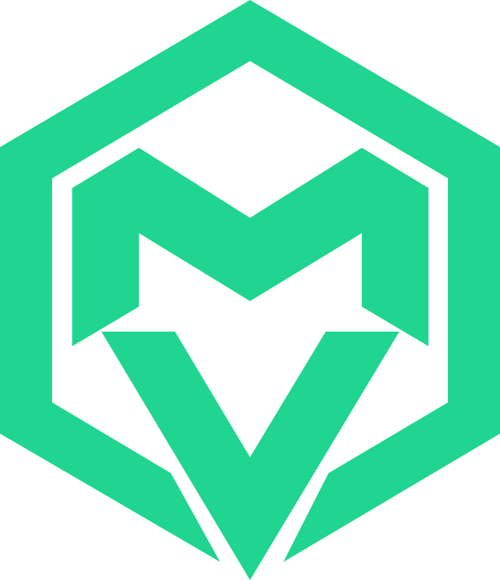

<p align="center"></p>
<h1 align="center">MV Spatial · Matías Villalobos</h1>
<p align="center"><strong>Unity Developer | XR / VR Developer</strong></p>
<p align="center">Personal projects, gameplay and interactive 3D experiences.</p>
<p align="center"><a href="https://matixvc.github.io/portafolio-web/">Visit the portfolio</a> · <strong>English</strong> · <a href="README.es.md">Español</a></p>
<p align="center">  </p>

## About

My personal portfolio presents personal and academic projects in game development, Unity, C#, interactive 3D and XR. It brings together project summaries, source repositories, bilingual CV downloads and professional contact details.

This development branch contains approved work through phases 9.1 and 9.2. The public website currently serves an earlier version from `portfolio/professional-refresh` and may differ from this branch.

## Features

- Responsive layouts for mobile, tablet and desktop.
- Light, Dark and System themes; System is the default. Explicit preferences persist when browser storage is available.
- MV Spatial SVG identity and a favicon that follows the system color scheme.
- Semantic sections, keyboard navigation, visible focus, a mobile menu, project dialogs and reduced-motion support.
- Project cards with details and repository links.
- Separate Spanish and English CV downloads.
- Web3Forms contact integration, field validation, duplicate submission prevention, email copying and email fallback.
- Static GitHub Pages hosting, with compiled CSS and the icon sprite committed to Git.

Real contact delivery is not tested during consolidation; no form submissions are authorized for QA.

## Projects and professional scope

| Project | Current scope | Source |
| --- | --- | --- |
| PhysicsVR Prototype | Unity/C# physical interaction prototype in development, intended for future VR integration. **Not yet functional with a VR headset.** | [Repository](https://github.com/Matixvc/PhysicsVR_Prototype) |
| Basura Fighters | Browser recycling roguelike with JavaScript and Canvas 2D. | [Repository](https://github.com/Matixvc/Trash-Roguelike) · [Demo](https://trash-rogelike.netlify.app) |
| App Mobile | Personal organizer with Expo, React Native and TypeScript. | [Repository](https://github.com/Matixvc/App-Mobile) |

The academic XR collaboration under NDA is separate from PhysicsVR. Its public description is limited to functional testing on Meta Quest 3 and issue reporting. Project illustrations currently use SVG mockups; real screenshots and media remain planned.

## Technologies

**Website:** static HTML, vanilla JavaScript and Tailwind CSS 3. Font Awesome supplies SVG sources for a local icon sprite. npm dependencies are development tools; the site requires no frontend framework or runtime npm bundle. Contact submission uses Web3Forms.

**Professional profile:** Unity and C# are the main focus, alongside gameplay, physical interaction, 3D and XR exploration. Unreal Engine, Python, Git/GitHub, Blender and Photoshop appear as complementary tools. They are not website dependencies. Expo, React Native and TypeScript belong to App Mobile.

## Project structure

```text
portafolio-web/
├── index.html
├── js/                     # main.js: interactions; theme.js: theme preferences
├── src/                    # input.css and historical CV/OG/icon templates
├── scripts/                # Icon generation, rendering and URL updates
├── assets/
│   ├── brand/              # MV Spatial SVGs, favicon and references/
│   ├── icons.svg           # Generated sprite
│   ├── Matias_Villalobos_CV_Unity_XR_ES.pdf
│   └── Matias_Villalobos_CV_Unity_XR_EN.pdf
├── dist/styles.css         # Generated CSS
├── docs/PROJECT_STATUS.md
├── AGENTS.md
├── README.md / README.es.md
├── package.json / package-lock.json
├── tailwind.config.js
└── site.webmanifest / robots.txt / sitemap.xml
```

## Local development

Requires Node.js and npm. Clone the development branch explicitly while publication remains separate:

```sh
git clone --branch feature/portfolio-consolidation https://github.com/Matixvc/portafolio-web.git
cd portafolio-web
npm ci
npm run build
npm run serve
```

The development branch is available on GitHub; see [PROJECT_STATUS.md](docs/PROJECT_STATUS.md) for consolidation evidence. Existing checkouts can use the local feature branch. `npm ci` installs locked versions. `npm run serve` uses `npx --yes serve .` and may download the server; use the URL printed in the terminal, normally `http://localhost:3000`. Stop with Ctrl+C. Use `npm.cmd` if PowerShell blocks `npm.ps1`.

| Command | Purpose |
| --- | --- |
| `npm run build` | Regenerate the icon sprite and minified CSS. |
| `npm run watch` | Recompile CSS while editing `src/input.css`. |
| `npm run icons` | Regenerate only `assets/icons.svg` from `scripts/build-icons.mjs`. |
| `npm run serve` | Serve the project locally. |
| `npm run set-url -- --dry https://example.com` | Preview metadata URL changes; remove `--dry` only for an intentional domain change. |
| `npm run og` | Render existing OG artwork through Microsoft Edge; overwrites generated resources. |
| `npm run cv` | Export historical `src/cv.html` to `assets/cv-matias-villalobos.pdf` through Edge. Does **not** update current ES/EN PDFs. |

Edit CSS/icon sources and regenerate outputs. Do not manually edit `dist/styles.css` or `assets/icons.svg`. Run OG/CV exports only within an approved resource update.

Basic checks: `node --check js/main.js`, `node --check js/theme.js`, `node --check tailwind.config.js`, `git diff --check`. There is no configured `npm test` or lint script. Browser QA should cover themes, reload/persistence, keyboard controls, menus, dialogs, CV links and responsive widths 390/768/1440. Do not submit the contact form without authorization.

## Git and publication

- **Current public branch:** `portfolio/professional-refresh`, last verified deployment `20b49ad`. Keep Pages settings intact.
- **Development:** `feature/portfolio-consolidation`, based on the recovered approved version.
- **Future workflow:** `main` for stable work and temporary `feature/*` branches; no permanent `develop`.
- Review diffs and staging, create focused commits, and version generated CSS/icons with their sources.
- Push feature branches only after verifying Pages/Actions triggers cannot publish them. Publication requires explicit approval.
- Moving publication to `main` is a future, separately authorized operation. This consolidation does not publish the new version.

GitHub is the primary backup after verifying the remote commit. Use temporary recovery resources only when necessary. Existing permanent backups, recovery references and stash require explicit approval before removal.

## MV Spatial identity

The approved mark combines an upper M, lower V and open hexagonal geometry. Reusable resources in [`assets/brand/`](assets/brand/): `mv-spatial.svg`, `mv-spatial-dark.svg`, `mv-spatial-light.svg`, `mv-spatial-monochrome.svg`, `favicon.svg`; original images are in `references/`.

Principal/dark emerald: `#20D58F`; light variant: `#07844F`; monochrome: `currentColor`. The header selects the effective theme variant. The interface retains cyan `#00F2FE`, violet `#7928CA` and blue `#0070F3` accents, with semantic light/dark tokens in `src/input.css`. A full MV Spatial design system remains pending.

## Status and roadmap

Completed through phase 9.2: integrity and functional improvements, professional positioning, theme preferences, and the approved MV Spatial mark/favicon. Evidence and limitations: [PROJECT_STATUS.md](docs/PROJECT_STATUS.md).

Planned:

- Phase 9.3: MV Spatial visual design system.
- Original Hero artwork and Projects Showcase.
- Project covers, screenshots and video.
- 3D models and experiences, animations and interactions.
- Professional banners and refreshed Open Graph artwork.

Existing ES/EN PDFs are preserved. Their PhysicsVR description needs a separately approved correction. They also mention 40 Days of Light, whose scope and evidence must be prepared before adding it to the website. Additional contact protection, broader browser/accessibility testing, an English website and case studies remain pending. No new AI banners are included.

## Contact

[Portfolio](https://matixvc.github.io/portafolio-web/) · [GitHub](https://github.com/Matixvc) · [LinkedIn](https://www.linkedin.com/in/matias-vc-dev) · [Email](mailto:Matias.villalobos.dev@gmail.com)

[CV · Español](assets/Matias_Villalobos_CV_Unity_XR_ES.pdf) · [CV · English](assets/Matias_Villalobos_CV_Unity_XR_EN.pdf)
